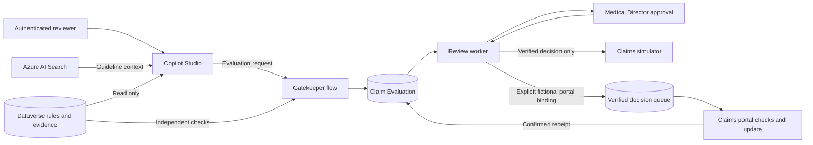

# Zava Medical Claims Concierge

A Copilot Studio solution for reviewing fictional medical insurance claims against a versioned medical policy. The agent gathers context, Power Automate checks the protected facts, and a Medical Director records the decision.

**Start with the [deployment guide](docs/deployment.md).** It covers configuration, package import, reviewer access and activation. The default deployment uses the simulator. An optional [portal connection](docs/portal-connection.md) can update explicitly allowed fictional claims after a verified Medical Director decision.

https://github.com/user-attachments/assets/40229fa7-e53e-48b4-bff0-0f961c89fa7c

## How it works

## Design Rationale

Generative models are useful for understanding requests, coordinating actions, and explaining results. Their answers are probabilistic, so business protections need an enforcement path outside the model's instructions.

When a prompt is the only control over claim decisions, the design is exposed to:

1. **Prompt injection:** a request or retrieved document may attempt to override instructions.
2. **Instruction drift and hallucination:** the model may apply a rule inconsistently or invent an authorization.
3. **Maintenance risk:** medical policy, claim evaluation logic, and conversational instructions become difficult to change and test independently.

### The Solution: The Gatekeeper Architecture

The design separates policy, intelligence, and execution:

- **Decoupled policy — Dataverse:** versioned medical policy rules and protected claim evidence live outside the prompt. The Gatekeeper reads them independently and applies the supported structured criteria. Missing or contradictory evidence blocks approval and requires review or additional information.
- **Bounded intelligence — Copilot Studio:** the agent retrieves guideline context, reads policy and evidence, submits an evaluation request, and explains the returned result. Its tools cannot change policy, edit protected evidence, or directly update a claim. Retrieved content and model reasoning cannot supply authorization.
- **Deterministic enforcement — Power Automate:** the Gatekeeper validates source bindings and policy criteria, then records a durable evaluation. A separate review worker verifies the authenticated Medical Director decision and rechecks current policy, evidence and claim state. It controls simulated operations or queues an explicitly bound fictional portal update; the portal independently checks the decision and protected facts before applying it.

The design keeps policy enforcement and claim operations in a checked process with required human review. Passing an evaluation establishes eligibility for review; a Medical Director must authorize the decision before any simulated or explicitly bound fictional portal change. The Gatekeeper pattern remains the central architectural decision.

## The Gatekeeper pattern explained

The agent can gather context, propose an evaluation and explain the result. Authority to act stays in controlled Power Automate flows. This keeps business protections outside the model's instructions, where prompt injection or inconsistent reasoning could otherwise affect a decision.

The design separates four responsibilities:

- **Policy and evidence in Dataverse.** Versioned rules and protected evidence live outside the prompt. Search results supply context; a citation alone does not establish a clinical fact or grant permission.
- **Coordination in Copilot Studio.** The agent has read tools and one evaluation-submission tool. It cannot edit policy, change protected evidence or directly update a claim.
- **Independent checks in the Gatekeeper.** The evaluation flow reads the authoritative rules, claim snapshot and evidence itself, validates their bindings and applies fixed policy checks. It records the outcome in a durable Claim Evaluation. Missing or contradictory evidence cannot authorize approval; passing the checks establishes eligibility for human review.
- **Human decision and controlled execution.** The separate review worker verifies the actual Approval responder against the assigned, configured Medical Director and rechecks policy, evidence and claim versions. An explicitly bound fictional portal operation also passes independent checks in the portal. Duplicate protection and receipt readback govern what can be reported as completed.

The reusable pattern is: **AI coordinates and explains; a controlled process enforces the rules and owns the write.** In this solution, that process also requires an authenticated human decision. Claims remain fictional, including those updated through the optional portal connection; see the [architecture](docs/architecture.md) for the execution boundary and POC limitations.

## What is included

| Component | Purpose |
|---|---|
| One Copilot Studio agent | Two tools read policy and evidence; one submits an evaluation |
| Three Dataverse tables | Versioned policy rules, protected evidence and durable evaluations |
| Two Power Automate flows | Evaluate the claim, then manage human review and completion |
| Claims Review app | Readable evidence and evaluation forms for the reviewer |
| Medical Director role | Open the app and read the three claims tables |
| Optional portal-worker role | Read protected decisions and Approval proof; record completion |
| Eight fictional examples | Exercise complete evidence, missing information and other policy cases |

The native solution is in `solution/src/`. It reuses an Azure AI Search index and requires no additional Azure compute service.

## Why I built this in Dev

I placed the whole solution in **Zava PP Lab Dev** because this is where I build, test, and refine it. I needed room to adjust the agent, change the rules, and troubleshoot the flows without putting unfinished changes into UAT or Prod.

Keeping the agent, flows, rule table, and connection references together in one unmanaged solution gives me an editable starting point and a package I can export and track in Git. It also keeps this project separate from the Default environment, which my lab design reserves for personal productivity.

Dev is the first step in my application lifecycle management (ALM) approach. UAT is where a release would be checked before production, and Prod is where approved changes would be deployed. This Concierge implementation has been built and demonstrated in Dev; I have not promoted it to UAT or Prod.

For instructions on setting up that environment structure, access controls, deployment pipelines, and approvals, visit my [Zava Power Platform ALM lab repository](https://github.com/aandino-zava/zava-power-platform-lab). Start with its [architecture and rationale](https://github.com/aandino-zava/zava-power-platform-lab/blob/main/docs/architecture-and-rationale.md), then follow the [deployment runbook](https://github.com/aandino-zava/zava-power-platform-lab/blob/main/docs/deployment-runbook.md).

## Deploy

1. Prepare an authorized Development environment and its Dataverse, Search and Approvals connections.
2. Follow the [deployment guide](docs/deployment.md) to configure the target and import a checked package. GitHub Actions is the primary route; a manual ZIP route uses the same package and checks.
3. Add the sample policy and evidence, configure the reviewer, and verify private access and tool bindings.
4. Complete the [acceptance checks](docs/testing.md), enable simulated processing and publish the agent.

Packages ship with both flows **Off** and processing disabled. Import does not transfer sign-ins, business records, reviewer assignments or agent publication. Keep completed target settings in the ignored `.local/` directory.

## Validation and scope

A native demonstration retrieved context, passed the conservative-policy checks and recorded a genuine Medical Director **ApproveAuthorization** response. The explicitly bound fictional portal claim moved from **Under Review, version 2** to **Approved, version 3**. Its portal timeline and Dataverse **PortalConfirmed** receipt agree. An earlier escalation example left its simulated claim unchanged. Automated checks cover the policy reference, deployment safeguards and portal connection controls.

Native portal denial and lost-acknowledgement recovery, approved or denied simulator writes, broader concurrency/failure cases, unauthorized-account sign-in and installation in another environment still require acceptance. This is a single-reviewer proof of concept with restricted application access, not a production claims adjudication system. See [validation and acceptance](docs/testing.md).

## Read further

- [Architecture and policy interpretation](docs/architecture.md)
- [Security controls](docs/security.md)
- [Demonstration](docs/demo.md)
- [Connecting fictional portal claims](docs/portal-connection.md)
- [Maintaining the solution](docs/maintenance.md)

Build and configure the solution in the Power Platform designers. GitHub Actions handles packaging and automated checks; supporting scripts and local verification details are covered in the [maintenance guide](docs/maintenance.md).

## License

This project is available under the [MIT License](LICENSE). See [NOTICE](NOTICE) for platform and third-party licensing boundaries.
