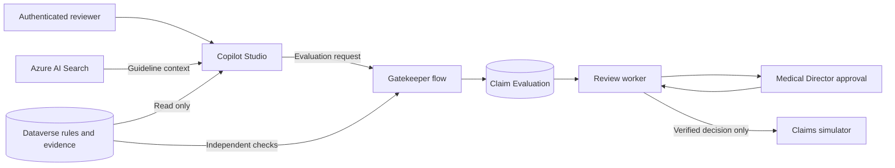

# Zava Medical Claims Concierge

A Copilot Studio solution for reviewing fictional medical insurance claims against a versioned medical policy. The agent gathers context, Power Automate checks the protected facts, and a Medical Director records the decision.

**Start with the [deployment guide](docs/deployment.md).** It covers configuration, package import, reviewer access and activation. All claim operations remain simulated.

## How it works

## The Gatekeeper pattern

The agent can gather context, propose an evaluation and explain the result. Authority to act stays in controlled Power Automate flows. This keeps business protections outside the model's instructions, where prompt injection or inconsistent reasoning could otherwise affect a decision.

The design separates four responsibilities:

- **Policy and evidence in Dataverse.** Versioned rules and protected evidence live outside the prompt. Search results supply context; a citation alone does not establish a clinical fact or grant permission.
- **Coordination in Copilot Studio.** The agent has read tools and one evaluation-submission tool. It cannot edit policy, change protected evidence or directly update a claim.
- **Independent checks in the Gatekeeper.** The evaluation flow reads the authoritative rules, claim snapshot and evidence itself, validates their bindings and applies fixed policy checks. It records the outcome in a durable Claim Evaluation. Missing or contradictory evidence cannot authorize approval; passing the checks establishes eligibility for human review.
- **Human decision and controlled execution.** The separate review worker verifies the actual Approval responder against the assigned, configured Medical Director. Before a simulated operation, it rechecks policy, evidence and claim versions. Duplicate protection and receipt readback govern what can be reported as completed.

The reusable pattern is: **AI coordinates and explains; a controlled process enforces the rules and owns the write.** In this solution, that process also requires an authenticated human decision. All claims operations remain simulated; see the [architecture](docs/architecture.md) for the execution boundary and POC limitations.

## What is included

| Component | Purpose |
|---|---|
| One Copilot Studio agent | Two tools read policy and evidence; one submits an evaluation |
| Three Dataverse tables | Versioned policy rules, protected evidence and durable evaluations |
| Two Power Automate flows | Evaluate the claim, then manage human review and completion |
| Claims Review app | Readable evidence and evaluation forms for the reviewer |
| Medical Director role | Open the app and read the three claims tables |
| Eight fictional examples | Exercise complete evidence, missing information and other policy cases |

The native solution is in `solution/src/`. It reuses an Azure AI Search index and requires no additional Azure compute service.

## Deploy

1. Prepare an authorized Development environment and its Dataverse, Search and Approvals connections.
2. Follow the [deployment guide](docs/deployment.md) to configure the target and import a checked package. GitHub Actions is the primary route; a manual ZIP route uses the same package and checks.
3. Add the sample policy and evidence, configure the reviewer, and verify private access and tool bindings.
4. Complete the [acceptance checks](docs/testing.md), enable simulated processing and publish the agent.

Packages ship with both flows **Off** and processing disabled. Import does not transfer sign-ins, business records, reviewer assignments or agent publication. Keep completed target settings in the ignored `.local/` directory.

## Validation and scope

A native demonstration retrieved context, passed the conservative-policy checks and saved an authenticated **Escalate** decision. The claim stayed unchanged. Automated checks cover the local policy reference and deployment safeguards.

Native approved or denied simulator writes, receipt reconciliation, unauthorized-account sign-in and installation in another environment still require acceptance. This is a private, single-reviewer proof of concept, not a production claims adjudication system. See [validation and acceptance](docs/testing.md).

## Read further

- [Architecture and policy interpretation](docs/architecture.md)
- [Security controls](docs/security.md)
- [Demonstration](docs/demo.md)
- [Maintaining the solution](docs/maintenance.md)

`scripts/` contains setup and packaging tools. `tests/` and `src/claims_concierge/` support automated checks; the Python reference is not deployed as a service. Required native component IDs and dependencies are retained for reliable packaging and import.
