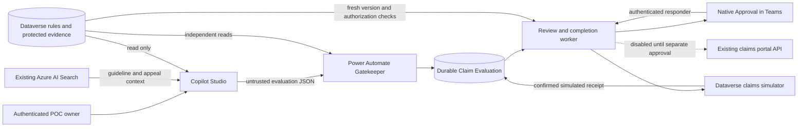

# Architecture and approved decisions

The solution uses Copilot Studio, Dataverse, Power Automate and an existing Azure AI Search index. It adds no Azure compute service. A local Python reference supports automated checks; the deployed Gatekeeper runs in Power Automate.



```mermaid
sequenceDiagram
    actor Owner
    participant Agent as Copilot Studio
    participant Gate as Gatekeeper
    participant DV as Dataverse
    participant Worker as Review worker
    actor MD as Medical Director
    participant Sim as Claims simulator
    Owner->>Agent: Evaluate synthetic claim
    Agent->>Agent: Retrieve context and propose facts
    Agent->>Gate: Strict evaluation payload
    Gate->>DV: Re-read rules, claim and evidence
    Gate->>Gate: Validate sources and deterministic conditions
    Gate->>DV: Record versioned evaluation/idempotency key
    Gate-->>Agent: Outcome, reasons and evaluation ID
    DV->>Worker: New review request
    Worker->>MD: Assigned native Approval with secure evidence link
    MD->>Worker: Decision and rationale
    Worker->>DV: Verify responder, binding, expiry and fresh state
    alt Missing evidence, stale request or unauthorized response
        Worker->>DV: Block or request reevaluation; no claims operation
    else Authorized human decision and valid current state
        Worker->>Sim: Controlled synthetic operation
        Sim-->>Worker: Simulated receipt
        Worker->>Sim: Read back operation/state
        Worker->>DV: Confirmed simulated result, attribution and correlation
    end
```

## Clinical policy interpretation

The source guideline's Section I allows a red-flag alternative to conservative therapy. R01/R02 are scoped to conservative therapy. Their natural-language seed text remains unchanged; structured fields define the applicable path, minimum six complete weeks, two attended PT sessions in every complete week, pharmacologic coverage, indication and failed/worsening symptoms. Clinical interpretation is a human responsibility.

Section II's missing-documentation denial wording differs from the approved POC behavior. R03 halts approval and routes for review or additional information. The system never converts a missing value into final denial. This is an explicit POC policy override, not a claim that the original guideline says the same thing.

Therapy intervals are start-inclusive/end-exclusive. Duration is complete seven-day intervals anchored at treatment start; the reference does not round 41 days up to six weeks or use an average PT frequency. It accepts at most one attended session per day. Medication coverage must span the selected treatment interval. These conservative POC conventions require clinical governance before production use.

Policy effective dates are evaluated against the authoritative synthetic claim service date; end dates are exclusive. An appeal cannot select a version outside that effective interval. Before a decision, the same version must still be active and its snapshot unchanged.

## Evidence authority

Search citations establish retrieval provenance, not the truth of extracted clinical facts. The existing corpus contains an appeal and guideline, without the PT logs the appeal says are attached. That remains a missing-evidence example. The complete-evidence scenarios are separate, explicitly fictional CSV/JSON fixtures; none is silently attached to a live portal claim.

The protected evidence table holds source bodies, ingestion hashes, a source version, a claim snapshot and reviewed facts. The native Gatekeeper must independently decode and compare source facts against that snapshot. Power Automate has no general SHA-256 expression; ingestion computes hashes and the flow compares immutable source/version/content snapshots. Agent tools cannot write those records. Dataverse auditing and restricted writers provide attribution; an administrator can still change configuration.

A small native Claims Review model-driven app/form presents readable evidence and evaluation summaries, policy requirements and protected source records. Native Approvals links to that review context. The app reuses the same tables and roles and adds no service or business-data copy. The app is published and its running locked evidence/evaluation forms were verified in Dev. The local report remains separate reference evidence.

`SyntheticFixture` is a distinct verification state, never an assertion that a real clinician signed those facts. `ClinicianVerified` requires a recorded actual verifier. The local test code supplies simulated identity contexts. Native acceptance must use genuine authenticated tool and Approval output.

## Schema and rule semantics

Dataverse retains its platform GUID. The text rule identifier is the primary display value and part of an alternate key with policy version. Evidence has a unique evidence ID and claim/version key. Evaluation request keys enforce duplicate submission detection.

R03 does not run eligibility predicates. Integer thresholds are unset; Boolean columns may surface Dataverse's false default and are ignored for that rule kind. A true eligibility requirement on R03 is rejected as inconsistent configuration. This prevents an escalation rule from acquiring conservative-path requirements accidentally.

Outcomes (`EligibleForHumanReview`, `InsufficientEvidence`, `PolicyCriteriaNotMet`, `MedicalDirectorReviewRequired`, `EvaluationError`) describe evaluation. Decision/execution states are separate. Approvals are permitted only after verified conservative eligibility or the verified red-flag path. Missing/contradictory evidence must be resolved and reevaluated before approval. A human may record a denial, information request or escalation with rationale; the model cannot.

## Identity and transactions

For the initial POC, agent sharing and flow invocation stay private to the configured owner, who is also the designated Medical Director. No body field establishes identity. Read tools use user authentication. Native review validates the Approvals responder's Entra object ID, assignment, the protected configured MD allowlist and approval ID. This POC does not perform a fresh security-role membership lookup at response time. Broader multi-user use is out of scope until authenticated caller binding is verified independently of saved owner connections.

Evaluation and claims operations are separate transactions. The reference uses two durable SQLite databases to test that boundary. A one-time decision reserves processing before the operation. Duplicate or conflicting decisions cannot produce a second write. After a timeout, an operation stays uncertain until a matching receipt is read back. Absence of a receipt is not permission to retry.

The Dev simulator uses only protected synthetic snapshots and uniquely keyed receipts in Claim Evaluations. It does not change the Azure claims portal. Its native worker implements serialized processing, ETag reservations and explicit reconciliation states. The native escalation path was verified; the native mutation/reconciliation branch remains unexercised. A receipt is confirmed only after the intended synthetic state and matching operation are read back. No production atomicity is claimed for a multi-step cloud flow.

The initial native worker is deliberately single-concurrency, including its Approval wait. This limits throughput and can delay other queued cases; check expiry before dispatch and process the small POC cases sequentially. A production design needs independent review dispatch/wait and a short commit worker with per-claim concurrency controls. The local reference's parallel tests do not establish native throughput or transaction guarantees.
